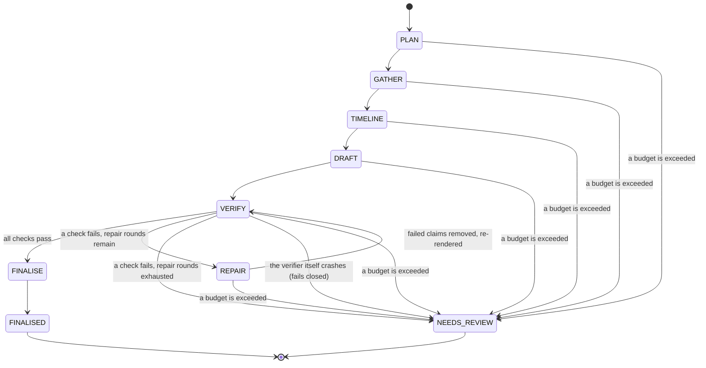

# Investigation Agent Architecture (Phase 4)

Scope: the investigation state machine, read-only tools, the dossier
model and generation, citation/claim verification, budgets, the human
review workflow, QC seeding, and adversarial tests. API endpoints and
frontend are Phase 5; release work is Phase 6 -- out of scope here, per
the brief.

## State machine

`ledgerlight/agent/state_machine.py`'s `run_investigation` runs one real
investigation through seven states, checkpointing (`InvestigationStep`,
committed, not just flushed) after every transition so a real process
crash resumes from the last completed state.

- **PLAN**: a fixed, deterministic default plan (the five read-only
  tools below, always in the same order). An optional LLM plan,
  validated against this same fixed allowed-tool list, is the brief's
  own §4 design -- not built in this environment (no `LLM_PROVIDER`/key
  in `.env`; see `docs/adr/0007-investigation-agent.md`).
- **GATHER**: calls all five tools (§3 below) for the real company/as_of.
- **TIMELINE**: persists real `timeline_entry` claims for real filings
  (event-kind timeline entries are covered by the real `event` claims
  GATHER/DRAFT already build, so are not duplicated here).
- **DRAFT**: persists real `event`/`metric`/`risk_signal`/`limitation`
  claims from the gathered tool output, then renders a first dossier via
  the offline template renderer (`ledgerlight/agent/render.py`).
- **VERIFY**: runs the real verifier (`ledgerlight/agent/verifier.py`,
  see `docs/agent/verifier.md`) against every active claim and the
  rendered sentences. A verifier crash or timeout is caught here and
  fails closed to `NEEDS_REVIEW` -- never propagates uncaught, never
  silently passes.
- **REPAIR**: marks failed claims `verification_status="failed"` and
  re-renders from the remaining active claims -- REPAIR never deletes a
  claim row (this project never deletes real rows) and never substitutes
  a new, different unsupported claim in place of a failed one.
- **FINALISE**: sets `final_status="FINALISED"`.
- Either terminal outcome persists exactly one real `Dossier` row (a new
  version each time a dossier is re-rendered for the same investigation)
  and then calls `ledgerlight.agent.review.create_review_tasks` to route
  real review tasks automatically (`docs/agent/review-workflow.md`).

## Module layout

| Module | Responsibility |
|---|---|
| `tools.py` | the 7 read-only tools, each returning a frozen `ToolEnvelope[T]` |
| `budgets.py` | `BudgetConfig`/`Usage`, enforced every step and every tool call |
| `claims.py` | builds `ClaimDraft`s from tool output |
| `render.py` | the offline, deterministic template renderer |
| `nli.py` | real local DeBERTa entailment scoring |
| `verifier.py` | the full per-claim and per-sentence verifier |
| `state_machine.py` | the orchestration above |
| `export.py` | Markdown/JSON dossier export |
| `review.py` | routing, reason codes, the append-only audit, the feedback loop |
| `qc_seed.py` | seeded QC injection and catch-rate reporting |
| `eval.py` | the Sec8 SEED+UNIVERSE evaluation |

## Data model

`investigations` (one row per real run, checkpointed via
`investigation_steps`) -> `claims` (the real source of truth for every
piece of dossier content, each with a real evidence-span list) ->
`dossiers` (immutable; a new row per re-render, never edited in place)
-> `review_tasks` (routed automatically, or seeded by `qc-seed`) ->
`review_decisions_audit` (append-only). `event_versions` records every
reviewer feedback decision as a new, immutable row -- `events.status`
itself is never mutated in place.

See `ledgerlight/agent/models.py` for the real column-level detail and
migration `a3e14b3deee1` for the schema itself.
