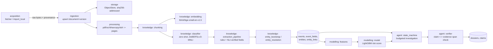
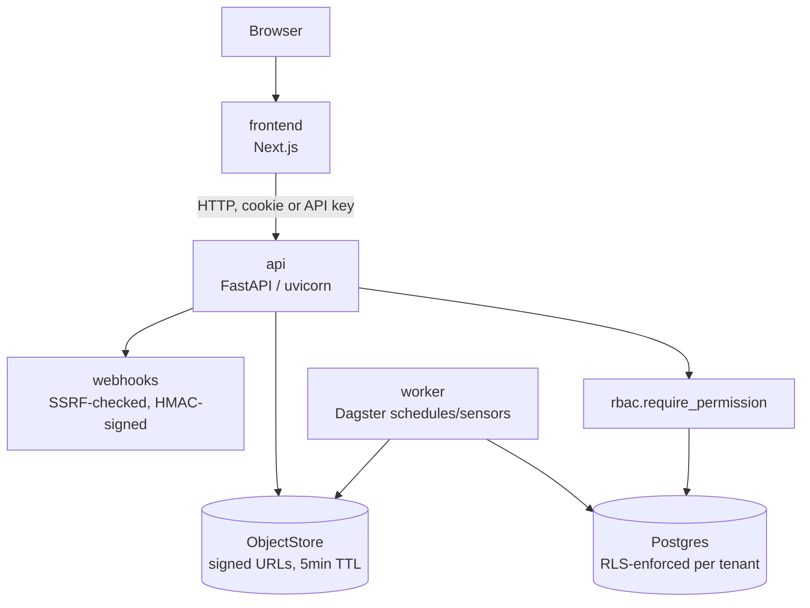

# Architecture

System-level architecture: real modules, real data flow, as the code
is today (Phase 6A). `docs/deploy/aws-architecture.md` covers the AWS
deployment topology specifically; this doc covers what runs where and
how data moves through it, independent of deployment target.

## Modules

| module | real responsibility |
|---|---|
| `ledgerlight.acquisition` | Fetches/imports raw documents -- `fetcher.py` (polite, robots.txt-respecting HTTP client), `import_local.py` (manual-download inbox), `manifest.py` (append-only provenance records). |
| `ledgerlight.ingestion` | Per-source discovery and backfill logic (`sebi.py`, `ibbi.py`, `care.py`, `nse_bhavcopy.py`, `known_items.py`), `upsert.py` (idempotent document/version upsert), `backfill_from_manifest.py`. |
| `ledgerlight.processing` | Turns a raw document into pages/text -- `document_processor.py`, `pdf.py` (PyMuPDF extraction), `ocr.py`, `bhavcopy.py`, `xbrl.py`, `limits.py`/`runner.py` (subprocess-isolated, timeout-bounded parsing). |
| `ledgerlight.knowledge` | Chunking, embedding, zero-shot classification, rules-based + NLI-verified event/field extraction, entity resolution (`chunking.py`, `embedding.py`, `classifier.py`, `extraction_pipeline.py`, `entity_bootstrap.py`, `entity_resolution.py`). |
| `ledgerlight.modelling` | Feature engineering and the real LightGBM risk-scoring model (`features.py`, `model.py`, `outcomes.py`). |
| `ledgerlight.agent` | The investigation state machine, budgeted tool-calling loop, claim verification, dossier/template rendering (`state_machine.py`, `budgets.py`, `verifier.py`, `claims.py`, `nli.py`). Never calls a live LLM -- see the model card. |
| `ledgerlight.api` | FastAPI app: routers, RBAC, RLS-aware session handling, auth/CSRF/webhooks (`app.py`, `routers/`, `rbac.py`, `deps.py`). |
| `ledgerlight.orchestration` | Dagster assets/jobs/schedules/sensors that drive acquisition+ingestion on a schedule. |
| `ledgerlight.db` | SQLAlchemy models + Alembic migrations -- the single source of truth for schema (`docs/data-dictionary.md` is generated from this). |
| `ledgerlight.storage` | `ObjectStore`: S3-compatible client (Garage locally, S3 on AWS), content-addressed by sha256. |
| `ledgerlight.review_pack` | Phase 6A's own human-review infrastructure (audit trail + deterministic sampling), shared by all 5 review tools. |
| `frontend` | Next.js app -- dossiers, companies, watchlists, alerts, review queue, tenant admin. Talks to `api` over HTTP only; no direct DB access. |

## Pipeline: raw document to risk score

Every arrow above is a real, exercised code path (`scripts/measure_cost_per_filing.py`
measures the real per-stage cost of exactly this chain -- see
`docs/ops/cost-per-filing.md`). The agent never calls a live LLM: it
renders dossiers through a real offline template
(`docs/modelling/model-card.md`), and the only two ML models in the
whole pipeline are the embedding model and the DeBERTa NLI model,
both run locally on CPU.

## Request flow (live API + frontend)

`api` and `worker` are two separate real processes/containers
(`infra/docker-compose.yml`) sharing the same codebase and database --
`worker` runs scheduled acquisition/ingestion plus the Dagster
webserver, `api` serves the real HTTP surface. Neither trusts the
frontend's own permission checks; every RBAC/RLS boundary is enforced
server-side (`docs/security/threat-model.md`).

## Tenancy model

Two kinds of data, by design (`docs/security/threat-model.md`'s own
"Assets" section):

- **Tenant-owned** (watchlists, alerts, API keys, webhooks, users,
  audit logs): Postgres Row-Level Security on every table, enforced
  for the restricted `ledgerlight_app` role (no `BYPASSRLS`).
- **Public reference data** (companies, documents, events, scores,
  dossiers): global, read-only to every tenant, no row-level
  isolation needed -- there is nothing tenant-specific in it.

## Real constraints this architecture lives with

- **No live LLM call anywhere** -- a deliberate project-wide ground
  rule (Phase 4), not a cost optimisation. Every "AI" step (embedding,
  zero-shot classification, NLI verification) is a small, local,
  MIT-licensed open-weight model run on CPU.
- **PDF extraction (`pymupdf`) carries a real, currently-unresolved
  AGPL-3.0/commercial licensing question** -- see
  `docs/compliance/data-sources.md` and `docs/release/release-gates.md`.
  Blocks a commercial/SaaS launch of this functionality until
  resolved, does not block research/internal use today.
- **Host memory has been a real, recurring constraint** throughout
  Phase 6A's own validation work (nothing to do with this
  architecture's own design) -- `docs/ops/performance-and-reliability.md`.
