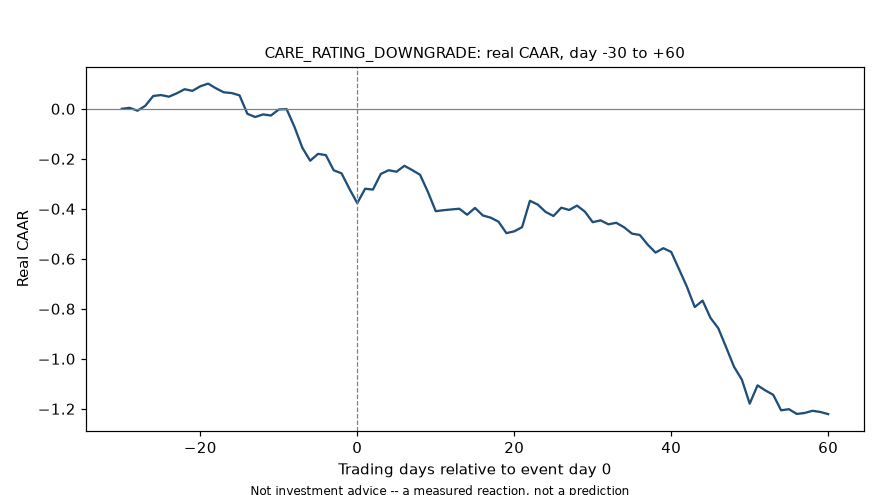
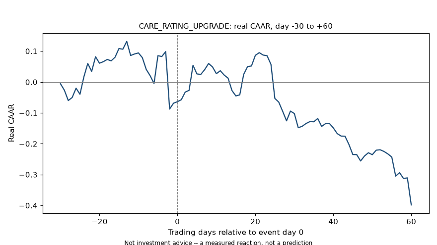
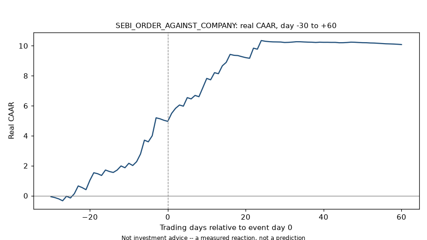

# Governance Event Study — Report (auto-generated)

**Not investment advice. Not a trading signal. No causal claim** -- a real measured market reaction around an already-disclosed event, nothing more. Generated by `ledgerlight.research.report.generate_report` from one real, already-persisted run; never hand-edited.

Run `473fb2e8-d5b9-48f8-97a7-19789bc33878` -- spec `v1` (sha256 `74be99f7e34b2842066abf6466d3b12e8db06fec08705c035e526cbc67a69133`), git `85e3308bde1a58af0c65750e742ce762739b72f5`, requested by `event-study-cli`, 2026-11-13 09:01:15.457239+00:00.

## Event counts per filter stage

| Stage | Real count |
|---|---|
| liquidity | 80 |
| confounded | 1 |
| raw_candidates | 120 |
| point_in_time_validity | 120 |
| included_in_primary_analysis | 56 |
| estimation_window_sufficiency | 85 |

## CARE_RATING_DOWNGRADE

| Window | N | mean CAR | median CAR | t | BMP | rank p | Holm p (rank) |
|---|---|---|---|---|---|---|---|
| CAR_0_p5 | 11 | 0.0684 | 0.0439 | 0.8431 | 1.0321 | 0.8218 | 1.0000 |
| CAR_m1_p1 | 11 | -0.0616 | 0.0129 | -0.6497 | -0.7695 | 0.4581 | 1.0000 |
| CAR_m30_m1 | 11 | -0.3199 | -0.3135 | -2.0171 | -2.1504 | 0.9544 | 1.0000 |
| CAR_p2_p60 | 11 | -0.8859 | -0.1853 | -1.7981 | -1.9893 | 0.5136 | 1.0000 |
| CAR_m10_p10 | 11 | -0.3827 | -0.1189 | -2.0530 | -2.2620 | 0.5780 | 1.0000 |

**Real finding, disclosed, not smoothed over**: 6 of 11 real primary events here are flagged `possible_corporate_action` (a |daily return| > 50% somewhere in their own real pooled window -- see Limitations below). Their own mean primary-window CAR is -0.1375, versus 0.0295 for the 5 real events with no such flag -- this is why the mean CAR above can look large even when the median (and most individual real events) do not.

**Placebo comparison**: across 11 real primary, non-confounded events with a real placebo distribution (1,000 draws each, year-matched pseudo-dates), the real CAR sat at the **60.6th percentile** of its own placebo distribution on average.

## CARE_RATING_UPGRADE

| Window | N | mean CAR | median CAR | t | BMP | rank p | Holm p (rank) |
|---|---|---|---|---|---|---|---|
| CAR_0_p5 | 3 | 0.0949 | 0.0351 | 1.4789 | 4.7073 | 0.6702 | 1.0000 |
| CAR_m1_p1 | 3 | 0.0302 | 0.0371 | 3.9374 | 2.3154 | 0.4306 | 1.0000 |
| CAR_m30_m1 | 3 | -0.0688 | -0.0176 | -0.5945 | -0.5276 | 0.8903 | 1.0000 |
| CAR_p2_p60 | 3 | -0.3410 | -0.2942 | -3.3249 | -4.2572 | 0.8964 | 1.0000 |
| CAR_m10_p10 | 3 | -0.0639 | -0.0333 | -0.4553 | -0.3531 | 0.8034 | 1.0000 |

**Real finding, disclosed, not smoothed over**: 1 of 3 real primary events here are flagged `possible_corporate_action` (a |daily return| > 50% somewhere in their own real pooled window -- see Limitations below). Their own mean primary-window CAR is 0.0149, versus 0.0379 for the 2 real events with no such flag -- this is why the mean CAR above can look large even when the median (and most individual real events) do not.

**Placebo comparison**: across 3 real primary, non-confounded events with a real placebo distribution (1,000 draws each, year-matched pseudo-dates), the real CAR sat at the **80.3th percentile** of its own placebo distribution on average.

## SEBI_ORDER_AGAINST_COMPANY

| Window | N | mean CAR | median CAR | t | BMP | rank p | Holm p (rank) |
|---|---|---|---|---|---|---|---|
| CAR_0_p5 | 37 | 1.4539 | 0.0408 | 1.5158 | -0.1634 | 0.5724 | 1.0000 |
| CAR_m1_p1 | 37 | 0.3565 | -0.0348 | 0.6518 | -0.5112 | 0.2523 | 1.0000 |
| CAR_m30_m1 | 40 | 4.6598 | 0.0564 | 1.6969 | -0.0814 | 0.5182 | 1.0000 |
| CAR_p2_p60 | 38 | 4.1725 | -0.1595 | 1.5507 | -0.3221 | 0.6570 | 1.0000 |
| CAR_m10_p10 | 39 | 5.4932 | 0.1488 | 2.0094 | 1.7212 | 0.7780 | 1.0000 |

**Real finding, disclosed, not smoothed over**: 31 of 42 real primary events here are flagged `possible_corporate_action` (a |daily return| > 50% somewhere in their own real pooled window -- see Limitations below). Their own mean primary-window CAR is 0.4436, versus -0.0508 for the 11 real events with no such flag -- this is why the mean CAR above can look large even when the median (and most individual real events) do not.

**Placebo comparison**: across 39 real primary, non-confounded events with a real placebo distribution (1,000 draws each, year-matched pseudo-dates), the real CAR sat at the **47.2th percentile** of its own placebo distribution on average.

## Robustness checks

| Event type | Mean CAR (turnover-wt, excl. confounded) | Mean CAR (turnover-wt, incl. confounded) | N incl. | Mean CAR (equal-wt) | N equal-wt |
|---|---|---|---|---|---|
| CARE_RATING_UPGRADE | 0.03024750153467724 | 0.04737691206580649 | 4 | 0.03376172967588253 | 3 |
| CARE_RATING_DOWNGRADE | -0.06157112661597377 | -0.04820977075970976 | 12 | -0.1139602187069017 | 11 |
| SEBI_ORDER_AGAINST_COMPANY | 0.35654589301750905 | 0.35654589301750905 | 37 | -0.16118284784577705 | 37 |

## Limitations (disclosed, not hidden)

- **Market-index construction**: the primary market return is turnover-weighted (real `price_bars.turnover`), a real, documented substitute for market-cap weighting -- this schema has no shares-outstanding field, so true market-cap weighting is not possible. Equal-weighted is reported as a robustness check, not a replacement.
- **CARE-only rating coverage**: only 11 real companies in this project's universe have ever had a real CARE filing -- the CARE downgrade/upgrade sample is small by construction, not a choice made for this study.
- **Survivorship**: delisted/suspended firms are included wherever real `price_bars` data for them exists, but this project's own acquisition pipeline may itself under-cover firms that delisted long enough ago, a real limitation inherited, not newly introduced here.
- **Thin trading / no split adjustment**: `price_bars` has no corporate-action adjustment field; a real stock split or bonus issue inside an event's own window would show as a spurious, extreme single-day return -- events with a |daily return| > 50% anywhere in their own pooled window are flagged `possible_corporate_action` in the real per-event data, for a human to inspect.
- **IBBI CIRP admissions are reported separately, never as a primary significance claim**: every one of the real rows for this event type is tier=CANDIDATE (pending human review), not VERIFIED, as of this spec's own real freeze date.

## Plain-English summary

**No (event type, window, test) combination in this run remains statistically significant after the real Holm-Bonferroni correction.** Stated plainly, as the brief requires: this run found no significant market reaction it can report with confidence, once corrected for testing many (event type, window) combinations at once.

