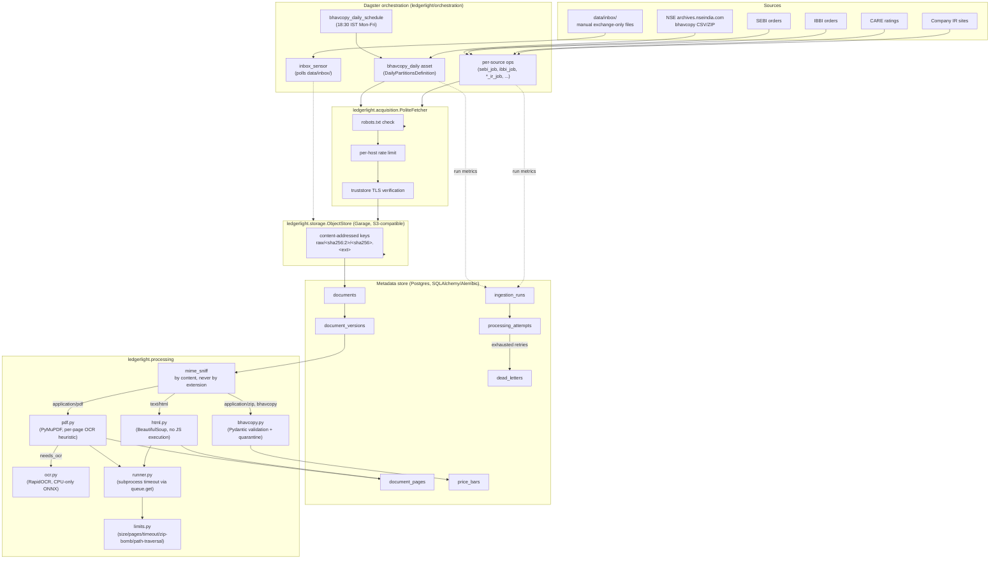

# Ingestion & Processing Architecture (Phase 1)

Scope: ingestion, raw storage, document processing, orchestration and
observability. Event classification, entity resolution, chunking/
embeddings, features/models, API and frontend are out of scope — Phase 2+.

## Pipeline

## Key design decisions (see linked docs for full detail)

| Decision | Doc |
| --- | --- |
| `known_at` evidence rule, IST→UTC | `docs/data/temporal-semantics.md` |
| Garage replaces MinIO (CVE) | `docs/adr/0003-object-storage.md` |
| SQLAlchemy/Alembic + Dagster, two real compatibility bugs found/fixed | `docs/adr/0004-metadata-store-and-orchestration.md` |

## Content-addressed storage

Object keys are `raw/<sha256[:2]>/<sha256>.<ext>` — the same content
(byte-identical download) always maps to the same key, so re-fetching an
unchanged document is a pure no-op (`ObjectStore.put_content_addressed`
checks existence before uploading, then verifies the hash on read-back).
A changed URL body creates a new `DocumentVersion` row (new `sha256`),
never overwrites the old one — `document_versions` is append-only.

## Document processing dispatch

`ledgerlight.processing.batch.run_process_all` is the single dispatcher
used by `scripts/process.py` and `scripts/reprocess.py`: bhavcopy ZIPs
(`source_id == "nse_archives"`) go to `price_loader.load_price_bars`;
everything else goes to `document_processor.process_version`, which
MIME-sniffs by content and no-ops cleanly for any type it has no
extractor for (never raises).

## OCR heuristic — real finding

The per-page OCR-needed heuristic
(`ledgerlight.processing.pdf.page_needs_ocr`) was refined after probing
the real ingested corpus: a naive "low character count ⇒ needs OCR" rule
false-triggered on graphic-design-heavy annual-report cover/divider pages
(e.g. 27 chars / 55 images, or 23 chars / 271 images — design layouts, not
scans). The fix adds an upper bound on image count
(`OCR_MAX_IMAGE_COUNT = 3`) alongside the existing image-area-ratio check.
**Programmatic probing of the full 237+ document corpus found zero
genuinely scanned pages** — every low-text page is a design layout. This
is reported honestly rather than claimed away: the OCR code path is
proven working against a committed SYNTHETIC fixture instead
(`tests/fixtures/synthetic_scanned_page.pdf`, `tests/test_ocr_engine.py`),
since the real corpus never exercises it.

## Per-document timeout — real bug found and fixed

The first implementation of `ledgerlight.processing.runner.run_with_timeout`
used `proc.join(timeout=...)` to detect completion, which does **not**
reliably signal promptly: PyMuPDF's native (non-Python) threads can keep
the OS process technically "alive" well after the Python-level worker
function has already produced its result and returned. This made a
29-page PDF (which actually finishes in ~3s) wait out the *entire*
60-second timeout before the parent noticed. Fixed by blocking on
`result_queue.get(timeout=...)` instead (which returns the instant a
result is available, independent of process liveness) and using
`proc.join()`/`.terminate()` only for best-effort cleanup afterward.

## Orchestration

Dagster definitions live in `ledgerlight/orchestration/definitions.py`:
one partitioned asset (`bhavcopy_daily`, daily partitions from
2017-01-01), one op per known-items source (SEBI/IBBI/CARE/9 company-IR
sites), an inbox sensor, and a daily 18:30 IST schedule. Dagster's own
run/event/schedule storage is a separate Postgres database
(`ledgerlight_dagster`) from the application schema — see ADR 0004 for
the two real compatibility bugs found while wiring this up (a
`from __future__ import annotations` incompatibility with Dagster's
context-type validation, and a psycopg3/`NOTIFY` incompatibility in
`dagster-postgres`).

Retries are Dagster's own `RetryPolicy` (max 2 retries) at the op/asset
level. `ledgerlight.ingestion.retry.run_with_attempt_tracking` is the
separate, durable audit trail: every attempt (success or failure) writes
a `processing_attempts` row, and the final allowed attempt's failure also
writes a `dead_letters` row — proven end-to-end in
`tests/test_retry_dead_letter.py` and `scripts/dead_letter_demo.py`.

## Observability

- Structured JSON logs (`structlog`) carry `run_id`/`source_id`/
  `document_id`/`stage` context; raw document text and secrets are never
  logged.
- `ingestion_runs` persists per-run counts (fetched/new/unchanged/failed/
  ocr_pages/rows_parsed/rows_quarantined), written by
  `ledgerlight.ingestion.run_tracking.start_run`/`finish_run` from every
  ingestion job and the batch processor.
- `scripts/ingest_report.py` (`make ingest-report`) prints per-source
  health, dead-letter counts by stage, and failure-class breakdowns.
- Every failure is classified into exactly one of `network`, `http_4xx`,
  `http_5xx`, `parse`, `timeout`, `limit_exceeded`, `validation`
  (`ledgerlight.ingestion.base.classify_exception`) — no bare `except` or
  silent swallowing anywhere in the ingestion/processing path.
