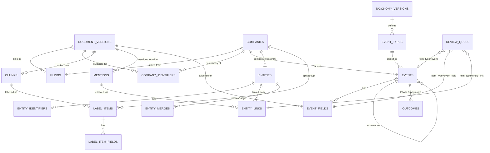

# Knowledge Schema (Phase 2)

18 tables, defined in `ledgerlight/knowledge/models.py`, sharing `Base`
(and therefore the Alembic migration history and the application
database) with Phase 1's ingestion schema
(`ledgerlight/db/models.py`) — Dagster's own run storage remains the
only separate database, per `docs/adr/0004-metadata-store-and-orchestration.md`.

Every timestamp is UTC `timestamptz`. Every extracted value is
traceable to `(evidence_version_id, evidence_page, evidence_char_start,
evidence_char_end, extractor_name, extractor_version, confidence)` —
see `docs/knowledge/extraction.md`.

## ER diagram

## Tables

### companies / company_identifiers
`companies` is deliberately thin (id, display_name, created_at).
`company_identifiers` carries the real history: identifier_type (`ISIN`,
`NSE_SYMBOL`, `BSE_CODE`, `CIN`), value, `valid_from`/`valid_to`
(NULL `valid_to` = currently valid), and source evidence
(`source_version_id` and/or `source_price_bar_id`). Bootstrapped from
real bhavcopy data by `scripts/bootstrap_companies.py` — one Company per
distinct ISIN, with NSE_SYMBOL rows segmented by contiguous validity
windows so a real symbol change (e.g. CROMPGREAV → CGPOWER, see
`docs/phase-2/phase-2-report.md`) is two rows, never an overwrite.

### filings
Links a `document_versions` row to the company/companies it relates to
— a version may relate to several (e.g. one NCLT listing page naming
several respondents). `link_method` (`company_identifiers_metadata` |
`document_metadata` | `filename_pattern` | `manual`) + `confidence`.
Never duplicates `documents`/`document_versions` — those stay Phase 1's.

### chunks
Page-aware: `char_start`/`char_end` index into that page's
`document_pages.raw_text`, and a chunk never crosses a page boundary
(enforced by construction — the chunker only ever sees one page's text
at a time). `chunker_version` is recorded so re-chunking under a new
version creates new rows rather than mutating old ones. `tsv`
(`TSVECTOR`, GIN-indexed) and `embedding` (`pgvector`, 384-dim,
cosine-indexed) back lexical/vector retrieval. `known_at` is copied from
the owning `document_versions.known_at` at chunk-creation time so the
point-in-time retrieval filter never has to join back.

### taxonomy_versions / event_types
Loaded wholesale from `data/taxonomy/taxonomy-v*.yaml` by
`scripts/taxonomy_load.py` — **never hand-inserted**. `event_types`
carries the full per-event-type definition (required/optional fields,
severity rules, detection approach, thresholds) as JSONB, so the YAML is
the single source of truth and the DB is a versioned, queryable copy of
it.

### events / event_fields
`events.status` is one of `candidate | verified | rejected |
needs_review`; `supersedes_event_id` is a self-FK so a corrected
re-classification creates a new row rather than overwriting the old one.
`event_fields` carries the evidence contract directly as columns
(`evidence_version_id`, `evidence_page`, `evidence_char_start`,
`evidence_char_end`) plus `extractor_name`/`extractor_version`/
`confidence`/`validation_status` (`validated | failed | unverifiable`).
A failed-verification field is still stored — never dropped — and is
what the review queue surfaces.

### entities / entity_identifiers / mentions / entity_links / entity_merges
`entities.entity_type` is one of `company | person | audit_firm |
rating_agency | other`; `company_id` is set when `entity_type='company'`,
linking back to the structured `companies` registry. `mentions` is
immutable (surface text + span); resolution lives in the separate
`entity_links` table (`method`, `score`, `status`) so a mention can be
re-linked later (e.g. after a merge) without mutating the mention
itself. `entity_merges` is reversible (`reversed_at`/`reversed_by`);
nothing is ever deleted.

### review_queue
Generic: `item_type` + `reference_id` (polymorphic, no FK constraint —
the reference's meaning depends on `item_type`), `reason_code`,
`priority`, `status` (`open | in_review | resolved | dismissed`),
`resolution`, `reviewer`, timestamps.

### label_items / label_item_fields
**Not explicitly named in the Phase 2 brief's table list, added because
the silver/gold labelling workflow (§4) needs somewhere to live.** One
row per labelled chunk (or whole page, if `chunk_id` is NULL):
`proposed_event_type_code`, `proposer_name`/`version`, `label_source`
(`ai_assisted_unreviewed` → `human_reviewed` only via the label-review
CLI — see `docs/knowledge/taxonomy.md`), `review_status` (`pending |
accepted | corrected | rejected`), `split` (`dev | validation | test`).
`label_item_fields` mirrors `event_fields`' evidence shape for
span-level field labels.

### outcomes
**Skeleton only** — `event_id`, `outcome_type`, `outcome_value`,
`observed_at`, all nullable except `event_id`. Phase 3 defines real
outcome_type values and populates this table; Phase 2 creates no rows
here. See ADR 0005.

### model_registry
`model_name` + `model_version` (unique together), `artifact_hash`,
`training_data_snapshot_hash`, `params_json`, `metrics_json`. Populated
by `scripts/train_classifier.py` for the TF-IDF+LR model; the DeBERTa
zero-shot model has no training data (nothing to snapshot) and is not
registered here, since it's never trained on this project's data.
